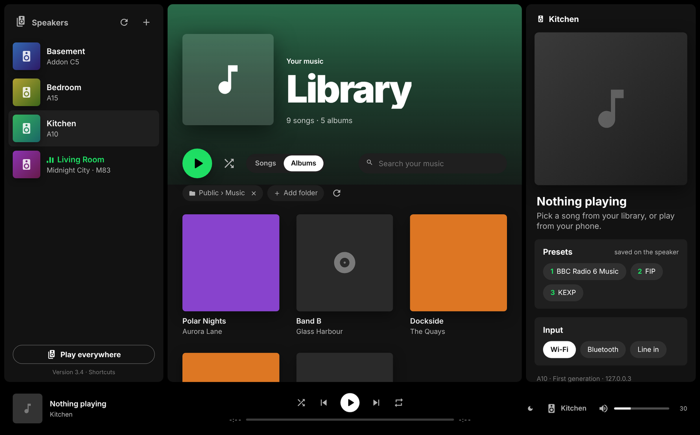
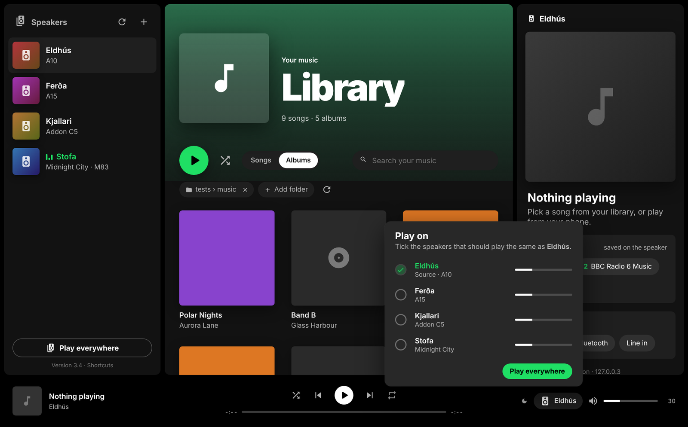
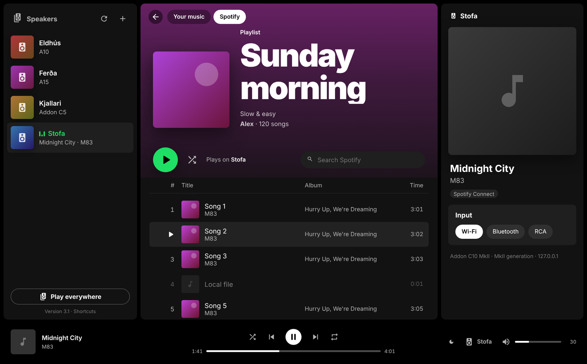
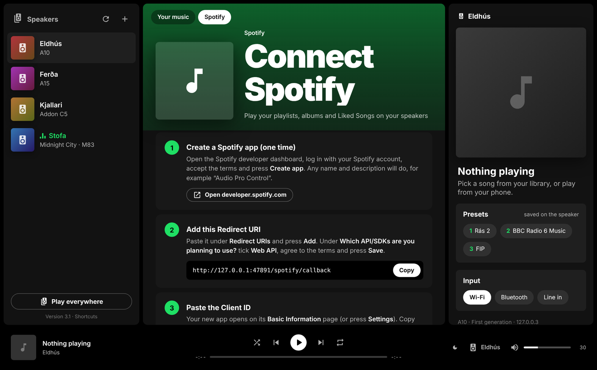

# Audio Pro Control

[](https://github.com/djingu/Audio-Pro-for-Windows/releases/latest)
[](LICENSE)

Control your **Audio Pro Wi-Fi speakers from Windows 11**: play, pause and set the volume, switch inputs, group speakers so they play the same music, play the music files on your PC, and browse and play **Spotify** on any speaker or group. The look is inspired by Spotify.

Works with both Audio Pro speaker generations, and you can mix them in one group:

- **First generation:** A10, A26, A36, Addon C3 / C5 / C10, Drumfire, Link 1 and others
- **MkII generation:** A10 MkII, C5 MkII, C10 MkII, A15, A28, Link 2 and others



## Features

- **Finds your speakers automatically** and remembers them, even when their IP address changes. You can also add one by IP address.
- **Now playing** for anything on the speaker, including Spotify Connect, AirPlay, Bluetooth, internet radio and Line in, with play / pause, next / previous, seek and volume.
- **Multiroom groups:** tick which speakers play together, set each one's volume, or press *Play everywhere*. Older speakers that group over Wi-Fi Direct are handled too.
- **Your music:** add folders with MP3, FLAC, M4A/AAC or WAV files. Covers and tags are read from the files. Browse by song or album, search, and use a play queue with shuffle and repeat. The PC streams the music to the speaker.
- **Spotify** (Premium): your playlists, Liked Songs, saved albums and Spotify search. Play on any speaker or group, add songs to the Spotify queue, and see Spotify's *Next up*. The speaker plays straight from Spotify, so the music keeps going if the PC sleeps.
- **Inputs and presets:** switch between Wi-Fi, Bluetooth, Line in and RCA, and start the presets saved on the speaker.
- Sleep timer, keyboard shortcuts, and its own taskbar icon that you can pin.

| Grouping speakers | Spotify |
|---|---|
|  |  |

## Install

1. Download **AudioProControl-3.3.zip** (or the newest version) from the [latest release](https://github.com/djingu/Audio-Pro-for-Windows/releases/latest) and unzip it anywhere. (Or click the green **Code** button on this page → **Download ZIP**; it contains the same files.)
2. Double-click **Install.bat**. It also updates an older version.
   - If Windows asks whether to run it, choose **Run** (or **More info → Run anyway**).
   - If Python 3 isn't installed, the installer fetches it with `winget` (one time, about 30 MB).
   - The app is copied to `%LOCALAPPDATA%\AudioProControl`, and Start menu and Desktop shortcuts are added.
3. The first time the app runs, Windows Firewall asks about **Python**. Tick **Private networks** and allow it. The app needs this to find the speakers and to stream your music files to them.

The app opens in its own window. It uses Microsoft Edge, which is built into Windows, to draw the interface. To keep it on the taskbar, right-click its taskbar button and choose **Pin to taskbar**.

**Requirements:** Windows 11 (Windows 10 should work too), and the PC on the same home network as the speakers. Python 3.10 or newer is installed automatically if needed. The app uses only the Python standard library, so there are no packages to install.

## Setting up Spotify

The Spotify tab walks you through this. It takes about two minutes, once. Spotify Premium is required.

1. Open [developer.spotify.com/dashboard](https://developer.spotify.com/dashboard), log in with your Spotify account, accept the terms and press **Create app**. Any name works, for example *Audio Pro Control*.
2. Under **Redirect URIs** add exactly this address (the app shows it with a Copy button):
   ```
   http://127.0.0.1:47811/spotify/callback
   ```
   Then tick **Web API** and press **Save**.
3. Copy the app's **Client ID** into Audio Pro Control and press **Connect**. A browser tab opens: log in to Spotify and press **Agree**.



Good to know:

- You don't need the *Client secret*. The app signs in with PKCE, and the sign-in is stored only on your PC in `%APPDATA%\AudioProControl\spotify.json`. **Disconnect** at the bottom of the Spotify page removes it.
- **Install the Spotify app on the PC too** (logged in to the same account). An Audio Pro speaker that hasn't played Spotify for a while is signed out, and only a Spotify app on your home network can hand it back in; Spotify's servers can't. When a speaker doesn't respond, Audio Pro Control opens Spotify on the PC minimised to do that, then tries again. Without it, start something on the speaker from Spotify on your phone once.
- **"<speaker> didn't start your Spotify"** or **"Spotify and <speaker> disagree":** after starting Spotify, the app checks with the speaker itself that it really switched. If it keeps playing something else, another phone or another Spotify account is using the speaker. Stop the music there (or pick another device in that Spotify app), then press **Take over** or try again.
- **"Spotify can't see <speaker>":** Spotify only lists speakers that are switched on and have been played to from your account. Pick the speaker once in the Spotify app on your phone (the devices button), and it works from then on. If Spotify knows the speaker by another name, choose that name in the same message.
- Spotify's rules for personal developer apps (since February 2026): the app can list the songs only in playlists you made or collaborate on. Other playlists, such as Spotify's own, still play with the play button. Searches show the top 10 results of each kind, and a personal app can be used by up to 5 Spotify accounts.

## Keyboard

| Key | Action |
|---|---|
| Space | Play / pause |
| Ctrl + ← / → | Previous / next |
| Ctrl + ↑ / ↓ | Volume |
| M | Mute |
| Ctrl + F | Search (your music or Spotify) |
| Enter | Play the highlighted song |
| Esc | Back / close |

## If something doesn't work

- **No speakers found:** check that the PC is on the same network as the speakers and that Python is allowed through the firewall on *Private* networks. You can also add a speaker with **+** and its IP address.
- **Your music won't play on a speaker:** the speaker has to be able to reach the PC. This is the same firewall setting as above.
- Right-click a speaker and choose **Copy diagnostics**. It copies exactly what the speaker reports. Include it if you [open an issue](../../issues).

## Optional: build a standalone .exe

Run **Build-Exe.bat**. It uses PyInstaller to build `dist\Audio Pro Control.exe`, which runs without Python installed.

## How it works

The app is one Python file (`AudioProControl.pyw`) and its interface (`ui.html`). The interface is served on `127.0.0.1` only, so it can't be reached from other computers.

- **Speakers:** the app talks to the speakers' local LinkPlay HTTP API and to UPnP. First-generation speakers use HTTP; MkII speakers use HTTPS on port 4443 with a client certificate.
- **Your music:** files are streamed from a small built-in media server.
- **Spotify:** the official [Spotify Web API](https://developer.spotify.com/documentation/web-api) is used for browsing and for starting playback. The music itself comes to the speaker through its built-in Spotify Connect.

Settings are stored in `%APPDATA%\AudioProControl`.

**Uninstall:** delete `%LOCALAPPDATA%\AudioProControl` and `%APPDATA%\AudioProControl`, and the two *Audio Pro Control* shortcuts.

## Credits

- The speaker protocol details and the LinkPlay client certificate come from [pywiim](https://github.com/mjcumming/pywiim) by Michael Cumming (MIT). See [THIRD_PARTY_NOTICES.md](THIRD_PARTY_NOTICES.md).
- Icons: [Material Icons](https://fonts.google.com/icons) (Apache 2.0).

This is an independent project. It is not made by or affiliated with Audio Pro, LinkPlay or Spotify. *Audio Pro* and *Spotify* are trademarks of their owners.

## License

[MIT](LICENSE)
